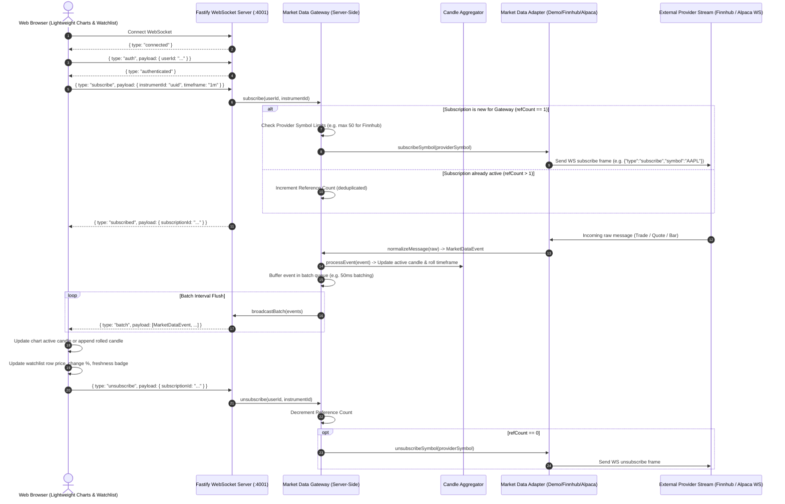

# Real-Time Market Data Architecture

## Sequence Diagram

---

## Gateway Design Principles
1. **Single Upstream Connection**: Providers like Finnhub and Alpaca strictly disallow multiple connections per API key. The server manages exactly **one** persistent WebSocket connection upstream per configured provider.
2. **Subscription Deduplication & Reference Counting**: When 100 users look at AAPL, only 1 subscription frame is sent upstream. Subscriptions are tracked with ref counts and only released when all subscribers leave.
3. **Symbol Capacity Protection**: If total subscribed unique symbols reach the provider's plan limit (e.g. 50 on Finnhub, 30 on Alpaca), new subscription requests are rejected gracefully with a `LIMIT_REACHED` event rather than crashing the socket.
4. **Batching**: Ticks are aggregated in a sliding window (default: 50ms) to prevent event-loop starvation in Fastify and unnecessary browser DOM repaints.
5. **Session-Aligned Candle Rolling**: 1m, 5m, 15m, 1h candle buckets are computed on UTC intervals with exchange session boundaries to prevent candle drift.
